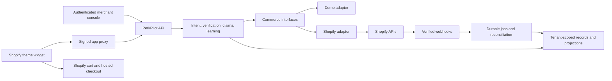

# PerkPilot: modular Shopify integration report

> **Status (Oct 18):** implemented as `PERKPILOT_MODE=shopify`: theme app extension, app proxy sessions, embedded admin with session tokens, Shopify-calculated totals, draft-order checkout, order reconciliation, Shopify refunds/returns/replacement orders, and metafield-published guidance. See the README. This report is kept as the design review it was built from.

Repository review and platform research: October 17, 2026.

**Recommendation:** turn PerkPilot into an installable Shopify app with a theme extension for shoppers, an authenticated merchant console, and a Shopify adapter behind the existing Python domain logic. Shopify should own catalog availability, cart, checkout, payments, orders, and operational returns. PerkPilot should own confirmed shopping requirements, verification explanations, evidence records, claims orchestration, and merchant-approved learning.

The product has a reusable workflow, but connecting a catalog API alone will not make it production-ready. Today it is both an assistant and a simulated commerce platform. Separate those roles before introducing real transactions.

Assumption for the recommended pilot: one merchant using a Shopify Online Store theme, initially selling footwear in one currency. A headless storefront and other product categories remain supported future directions, not prerequisites. The merchant's plan, theme, customer-account setup, fulfillment provider, and returns policies have not been supplied or tested.

## 1. What the repository does today

The application is Next.js 15/React 19 with a FastAPI/Pydantic backend. The frontend forwards `/api/*` to FastAPI. Persistence uses a small document-store interface backed by MongoDB or a local JSON snapshot. There is no Shopify app configuration, extension, installation flow, API client, or webhook integration in the tracked files.

The main flow is:

1. `ai.py` interprets a request through Gemini or a disclosed deterministic fallback.
2. `shopping.py` stores an intent and the shopper's versioned confirmation.
3. `verifier.py` checks a proposed variant, stock, offers, budget, payment method, and delivery against local documents; `pricing.py` calculates fixture totals.
4. `shopping.confirm_checkout()` re-verifies, decrements local inventory, records simulated authorization/settlement, and creates a simulated shipment.
5. `resolution.py` classifies complaints and executes simulated refunds or replacement orders.
6. `learning.py` aggregates confirmed fit outcomes and proposes guidance requiring merchant approval.
7. `metrics.py` displays results from those application events.

| Existing component | Reusable value | Required Shopify change |
|---|---|---|
| `backend/app/ai.py` | Structured interpretation, validation, explicit fallback | Merchant-specific taxonomy and options; remove fixed brand vocabulary; minimize customer data sent to the model |
| `models.py` | Explicit confirmation and request contracts | Replace single-line, USD, numeric US-size assumptions with normalized commerce models |
| `shopping.py`, `verifier.py` | Requirement versions, deterministic checks, explanation and reconfirmation | Inject platform snapshots; replace local order placement with Shopify checkout handoff |
| `pricing.py` | Budget comparison and separation of later benefits | Keep fixture arithmetic only in demo mode; use Shopify-calculated amounts in production |
| `records.py`, `core.py` | Canonical hashing and event trail | Version records for Shopify IDs, real timestamps, line items, payment observations, and evidence provenance |
| `resolution.py` | Complaint intake, abstention, policy-based options | Separate policy decisions from asynchronous Shopify return/refund execution |
| `learning.py` | Confirmed outcome aggregation and merchant approval | Tenant scoping, real policy thresholds, line-item cohorts, accurate outcome labels |
| `store.py` | Storage abstraction | Tenant-scoped repositories, unique indexes, atomic state transitions, durable jobs |
| `frontend/app/merchant/*` | Dashboard, claims, rule-review UI | Authenticated Shopify Admin app surface |
| `RequirementsForm`, `CheckList`, assistant UI | Shopper interaction patterns | Extract reusable widget components and remove `DemoProvider` dependencies |
| `fixtures.py`, `demo.py`, `evaluation.py` | Repeatable demonstrations and regression fixtures | Explicitly isolated demo/test adapter and database |

This is a platform-adapter refactor, not a reason to rewrite the Python services in JavaScript.

## 2. How it should embed in a real store

### Shopper-facing surface

Build a **theme app extension** with an app embed block for an assistant launcher/drawer and an optional product-page app block for inline fit guidance. The merchant enables the embed and places the inline block using the theme editor. Theme extensions are Shopify's supported integration mechanism for these surfaces. [Theme integration](https://shopify.dev/docs/apps/build/online-store/index), [extension configuration](https://shopify.dev/docs/apps/build/online-store/theme-app-extensions/configuration).

Package a small independent widget bundle. Reuse the requirements and check-list components after separating them from Next routing, the StrideLab shell, and demo state. Use scoped styles or a shadow root, accessible focus management, and lazy loading. Pass public product/variant context from Liquid; treat it as input, not authority. Do not inject the entire existing Next.js storefront into the merchant's theme.

For a theme-based store, update the customer's existing Shopify cart using the locale-aware Ajax Cart API. Preserve existing cart contents and refresh the relevant cart sections. Budget checks must explicitly cover either the assisted items or the whole cart; the current single-product schema cannot quietly become a whole-cart guarantee. [Ajax Cart API](https://shopify.dev/docs/api/ajax/reference/cart).

Use an app proxy, for example `/apps/perkpilot`, for widget-to-backend requests. The backend validates Shopify's proxy signature and timestamp, resolves the installed shop, and enforces authorization. Proxy requests do not forward normal cookies or support setting cookies in responses. Anonymous shoppers therefore need an explicit, short-lived application session token rather than an assumed proxy cookie session. A valid proxy signature identifies a Shopify-forwarded request; it does not make client totals or arbitrary identifiers trustworthy. [Proxy authentication](https://shopify.dev/docs/apps/build/online-store/app-proxies/authenticate-app-proxies).

If the merchant already uses a headless storefront, implement a separate Storefront Cart adapter using GraphQL cart mutations and `checkoutUrl`. Do not accidentally create a second Storefront API cart alongside an existing theme Ajax cart and assume they share state. [Storefront cart workflow](https://shopify.dev/docs/storefronts/headless/building-with-the-storefront-api/cart/manage).

### Merchant and post-purchase surfaces

Retain the merchant console, hosted by PerkPilot, and integrate it into Shopify Admin with authenticated app sessions. Installation authorization and merchant session authentication are separate concerns. Store server-side access credentials per installation and use offline access for background synchronization, including refresh handling where applicable. [Authentication](https://shopify.dev/docs/apps/build/authentication-authorization), [access tokens](https://shopify.dev/docs/apps/build/authentication-authorization/access-tokens).

Expose order records and claim entry through a customer-account extension where supported by the merchant's account setup. A hosted authenticated portal is a reasonable first implementation. Thank-you/order-status extensions can add a link after purchase; theme app embeds do not automatically render in checkout or customer accounts. [Customer accounts](https://shopify.dev/docs/apps/build/customer-accounts), [checkout extension surfaces](https://shopify.dev/docs/api/checkout-extensions).

For a single-store pilot, a Dev Dashboard/CLI app with custom distribution is appropriate. If the product will serve unrelated merchants, plan public distribution and review. Custom distribution supports a single store or stores within one Plus organization; the distribution method cannot simply be switched later. Use a separate app registration if the eventual distribution path requires it. [Distribution](https://shopify.dev/docs/apps/launch/distribution/select-distribution-method).

## 3. The critical distinction: advice versus enforced checkout

The current demo controls the entire transaction, so its approval check can immediately precede its simulated payment. Shopify checkout introduces a boundary where the shopper can change address, shipping, discounts, quantities, and payment choices.

| Integration level | What PerkPilot can honestly claim | Boundary |
|---|---|---|
| Theme widget pilot | Checks available cart information against confirmed preferences; records intent; reconciles completed orders | Widget can be bypassed; tax/shipping may be incomplete; final payment remains Shopify checkout |
| Shopify validation Function | Enforces the supported checks inside Shopify's server-side checkout path | Must prove supported inputs, authenticated intent binding, applicable channels, and availability for the merchant |
| Checkout UI extension | Shows confirmation/reconfirmation inside eligible checkout steps | UI is separate from server-side validation and cannot expose or control arbitrary payment credentials |

Shopify documents Cart and Checkout Validation Functions as the server-side validation mechanism. Custom apps containing Functions require Shopify Plus; public App Store apps containing Functions have broader plan availability, subject to individual capabilities. Checkout UI extensions at information, shipping, and payment steps require Plus. A non-Plus custom pilot should start with advisory verification. [Validation API](https://shopify.dev/docs/api/functions/reference/cart-checkout-validation), [Functions availability](https://shopify.dev/docs/apps/build/functions), [checkout UI availability](https://shopify.dev/docs/api/checkout-ui-extensions/latest).

Do a focused feasibility spike before promising the demo's exact maximum-charge protection. Verify that the pinned Function schema exposes the required total, currency, delivery, and cart data at the relevant stage. Python cannot simply be called from every Function invocation; Functions use a constrained WebAssembly execution model, and external network access has eligibility restrictions. Port only the supported deterministic subset and share test vectors with Python. [Functions execution model](https://shopify.dev/docs/apps/build/functions), [validation capabilities](https://shopify.dev/docs/api/functions/reference/cart-checkout-validation).

Bind any enforcement to an immutable, versioned approval containing shop, intended lines/quantities, currency, budget basis, expiry, and relevant delivery constraints. Browser-writable cart attributes or a quote ID alone are not proof of approval. Prove how the Function authenticates the binding using supported trusted inputs or a verifiable signed payload. Test removal, modification, replay, cart changes, direct checkout, and accelerated checkout. If that cannot be proven, keep the feature advisory.

Even with validation, specify exactly which constraints are enforced. A missing shipping estimate or unknown card-linked benefit must never be converted into a passing check. Add `UNKNOWN`/`UNSUPPORTED` outcomes alongside `PASS`/`FAIL`, with evidence timestamps and an explicit completeness indicator.

## 4. Proposed module boundaries



Define narrow interfaces instead of a single generic Shopify client leaking into every service:

| Interface | Responsibility | Current coupling to remove |
|---|---|---|
| `CatalogProvider` | Search sellable products; resolve variants and option mappings | Direct `store.find("products")` in recommendations/verifier |
| `CartProvider` | Read/update the active cart; normalize platform observations | `CartProposal` assumes one product and a fixture shipping option |
| `CheckoutGateway` | Handoff and supported validation capabilities | `confirm_checkout()` simulates payment/order creation |
| `OrderProvider` | Retrieve canonical order, lines, transactions and fulfillment | Local purchases and generated settlement/shipment events |
| `ReturnGateway` | Submit and reconcile approved return/refund operations | Inline mutations in `accept_remedy()` |
| `PolicyProvider` | Shop-specific return windows and approved guidance | `pol_stridelab` and global merchant assumptions |
| `IdentityProvider`, `Clock` | Trusted principal, shop, real time/timezone | Client shopper IDs, `MERCHANT_ID`, demo clock |

Suggested additions:

```text
backend/app/domain/                 normalized models and pure checks
backend/app/ports/                  commerce, identity, clock contracts
backend/app/adapters/demo/          current fixture behavior
backend/app/adapters/shopify/       API client, mapping, sync, operations
backend/app/auth/                  merchant, proxy, customer authorization
backend/app/webhooks/              signature verification and durable intake
backend/app/jobs/                  sync, reconciliation, remedy execution
extensions/perkpilot-theme/        Liquid blocks and widget assets
extensions/perkpilot-validation/   optional, after capability spike
frontend/widgets/                  reusable shopper components
shopify.app.toml                   app URLs, scopes, subscriptions, extensions
```

Inject these dependencies at `create_app()` rather than branching on `if shopify` inside every rule. Preserve the demo adapter for existing tests. Storage and commerce are separate abstractions: replacing `BaseStore` alone does not replace the pricing, payment, and fulfillment simulator.

## 5. Data ownership and mapping

Shopify is authoritative for commercial facts. The PerkPilot database stores a synchronized projection for search and analysis, plus application-owned intent and evidence records. Re-read important platform state before consequential actions; a webhook-fed cache is not an inventory reservation.

| Current field/model | Production representation |
|---|---|
| `m_stridelab` | Installation/shop identifier on every record, query, job, and cache key |
| `product_id`, fixture variant ID | Shopify product and variant GIDs plus explicit Ajax numeric ID mapping |
| `price_cents` on product | Variant/context-specific Money with currency; exact decimal conversion into valid minor units |
| `size`, `color` | Option-name mappings configured per shop; preserve original option values and size system |
| `inventory_by_variant` | Platform availability with location/channel/policy context and observation time |
| `CartProposal` | Cart identity and a list of line items, selling-plan context when supported, discounts, buyer market |
| Single-product purchase record | Order-level snapshot plus line-item snapshots; line-level claim targets and quantities |
| `pm_visa_4242`, `SIM-TXN` | Platform transaction references and observed statuses; unavailable details stay unavailable |
| `approved_delivery_date` | Sourced estimate or explicit promise, provenance, timestamp, and confidence/status |
| `carrier_fixture`, planned events | Fulfillment/tracking observations; partial shipments and missing delivery evidence supported |

SKU is not a safe primary key: it can be missing, duplicated, or edited. Product price is not necessarily the selected variant price. Arbitrary Shopify sizes such as `M`, `EU 43`, and width options cannot pass through the existing numeric half-size normalizer. An initial footwear pilot can constrain its supported catalog explicitly while implementing the general option mapping.

Keep money exact and distinguish shop currency from customer presentment currency. Shipping, taxes, discounts, duties, gift cards, and partial payments make “order total,” “amount collected,” and “refund remaining” different facts. Never transplant the demo's flat-tax arithmetic or compare amounts across currencies.

Create a version-2 record with separate sections for **shopper intent**, **pre-checkout observations**, **Shopify order facts**, and **reconciliation results**. Preserve original snapshots; append later observations instead of rewriting what the shopper approved. Store a non-sensitive record reference/hash in an order metafield only if useful. Hashes alone are not proof against a privileged database writer; use restricted append operations and protected external checkpoints if stronger audit guarantees are required.

## 6. Purchase and synchronization lifecycle

1. Install the app, authenticate the shop, store encrypted credentials, and record granted capabilities.
2. Import catalog with pagination (bulk operations if scale warrants), map options, and filter by intended sales-channel/market availability.
3. Subscribe to relevant product, inventory, order, fulfillment, refund/return, and uninstall changes supported by the selected API version and scopes.
4. Shopper confirms requirements. The widget updates the existing cart and stores a short-lived server-side intent/quote binding.
5. Show checks with their scope and completeness. Continue to Shopify checkout; do not emit a payment success event.
6. Receive authenticated order/payment observations and reconcile the order against the approved snapshot. An order-created event is not itself proof of payment.
7. Keep unlinked orders distinct. A copied cart attribute must not attach another customer's private intent; verify shop, session/customer ownership, correlation and line/currency consistency. Historical orders without PerkPilot approval must say “no prior PerkPilot approval.”
8. Reconcile missed or stale data periodically and expose sync failures to the merchant.

Verify webhook HMAC over the raw request body, persist delivery deduplication, and enqueue work durably before acknowledging. Workers should tolerate duplication and out-of-order observations, retrieve current canonical objects where needed, and retry throttling with backoff. Use a pinned supported API version, monitoring, and an upgrade process. [Webhook delivery verification](https://shopify.dev/docs/apps/build/webhooks/verify-deliveries).

Suggested permissions start with catalog/order reads, inventory reads if needed, and app proxy access. Add returns/refund write capabilities only when that phase is enabled. Exact scopes must follow the chosen GraphQL fields and mutations. Historical order access beyond Shopify's default window needs `read_all_orders` in addition to order access and applicable approval. Customer/order information can involve protected customer data requirements. [Access scopes](https://shopify.dev/docs/api/usage/access-scopes), [protected customer data](https://shopify.dev/docs/apps/launch/protected-customer-data).

## 7. Returns and learning require more than API substitution

Split `resolution.py` into complaint classification, policy evaluation, and effect execution. The first production release should let merchants review suggested remedies and execute them through their existing Shopify workflow. Observe those operations back into PerkPilot before adding automation.

Later, use Shopify return/refund operations with validated order-line quantities, remaining refundable amounts, transaction references, restocking policy, and required permissions. Creating a return and issuing a refund are distinct operations. Exchange support must be designed against the merchant's actual Shopify/returns workflow, including replacement availability and any price difference. Do not create a local zero-charge “replacement purchase” and call that a fulfilled exchange. [Return creation](https://shopify.dev/docs/api/admin-graphql/latest/mutations/returnCreate), [refund creation](https://shopify.dev/docs/api/admin-graphql/latest/mutations/refundCreate).

Use durable operation states such as `requested -> approved -> submitted -> confirmed`, with `failed` and `reconciliation_required` paths. A timeout after submission can mean Shopify succeeded; reconcile before retrying. Persist a unique logical operation key and use platform idempotency where supported. The existing accepted-remedy check and recorded `idempotency_key` do not provide atomic protection against concurrent requests or process crashes.

Remove push-to-card and fixture card-linked offers from production capabilities unless separately integrated with a real authorized provider. Shopify access alone is not evidence of a shopper's issuer-offer enrollment.

Correct the evidence model: tracking can support package-delivery status, while fulfillment line items describe what was recorded as shipped. Neither independently proves the physical contents delivered. `classify()` currently treats the fixture's `delivered_variant_id` as confirmed carrier evidence. Production wrong-item claims need a separate evidence status, photos/warehouse records where available, or merchant review.

Keep fit learning gated on real confirmed outcomes and merchant approval. Count line-level cohorts consistently, exclude demo/seeded data, distinguish imported history from assisted purchases, and account for incomplete delivery/outcome coverage. Current `metrics.py` counts exchange execution events under `exchanges_completed`; production should distinguish requested, shipped, delivered, and customer-confirmed exchanges. Do not present the demo thresholds or retained-order-value proxy as demonstrated return reduction.

## 8. Production blockers found in the code

These are concrete repository findings, not prerequisites invented by Shopify:

| Priority | Finding | Required change |
|---|---|---|
| P0 | `main.py` exposes reset, advance-clock, and product-price scenario endpoints; startup auto-seeds | Register demo routes and seed behavior only in explicit demo mode, isolated from real credentials/data |
| P0 | `DemoProvider` selects identity from local storage; request bodies supply shopper IDs | Derive identity server-side; bind anonymous sessions; verify customer ownership before order/claim access |
| P0 | Purchase detail ownership is optional; quote, intent, and claim reads lack consistent authorization | Enforce tenant and object ownership on every read and mutation |
| P0 | Merchant routes are unauthenticated and accept caller-supplied approval actor | Authenticate merchant sessions and staff permissions; derive audit actor from identity |
| P0 | Local read-modify-write inventory, counters, remedy execution, and event chains are non-atomic | Unique constraints, conditional updates/transactions, durable operation log; Shopify owns inventory effects |
| P0 | MongoDB failure falls back to a local file | Fail closed for production persistence; never fork live commerce state into a local snapshot |
| P1 | Global merchant, timezone, USD, policy ID, and unscoped searches | Tenant context throughout repositories, jobs, metrics, learning and AI configuration |
| P1 | Wildcard CORS and unauthenticated model/evaluation routes | Route-specific authentication, appropriate origin policy, rate limits and resource limits |
| P1 | Synthetic tax, delivery dates, card details and settlement evidence | Capability-based platform observations; explicit unknown states |
| P1 | Hash-chained events are writable documents with read-then-write sequencing | Atomic append strategy, protected audit storage and schema versioning |

Also implement credential encryption/rotation, uninstall revocation, retention/deletion workflows, and log redaction. Submit any required protected-data requests and implement applicable Shopify privacy webhooks before public launch. Keep complaints and identity data out of public cart attributes and minimize model inputs. [Protected-data requirements](https://shopify.dev/docs/apps/launch/protected-customer-data).

## 9. Staged implementation and acceptance gates

| Phase | Deliverable | Completion criteria |
|---|---|---|
| 1. Isolate commerce | Interfaces, tenant context, real clock, demo adapter, production config | Existing demo behavior remains reproducible; live mode cannot seed/reset/simulate payment; cross-shop access tests pass |
| 2. Read-only Shopify | Install/auth, catalog mapping, order import, webhook jobs, reconciliation | Product edits/deletes and order/payment changes converge; duplicate/reordered events are safe; uninstall stops access |
| 3. Embedded advisory pilot | Theme embed, product guidance, real cart handoff, intent/order reconciliation | Runs on the pilot theme/mobile; preserves existing cart; unknown totals are labeled; normal checkout still works if assistant fails |
| 4. Operational claims | Authenticated claim portal, merchant review, observed returns/refunds, learning | Customer can access only their records; refunds and deliveries reflect Shopify; no fabricated approval or package-content evidence |
| 5. Controlled automation | Durable Shopify remedy executor and reconciliation | Concurrent accepts cannot double-refund; timeout-after-success is recovered; partial refunds and external merchant actions are reconciled |
| 6. Stronger checkout control | Eligible Function and optional checkout UI | Tests prove available constraint enforcement, intent authenticity, reconfirmation and accelerated-checkout behavior; unsupported guarantees stay disabled |

For the first live merchant, deliver phases 1–4 with refunds still merchant-executed. This provides the assistant, real product context, purchase evidence, claims, and learning without depending on the hardest checkout enforcement work. If prevention of over-budget payment is the central launch requirement, phase 6's feasibility becomes an early go/no-go gate rather than a later enhancement.

Test beyond the current fixture suite: two-shop isolation; anonymous and signed-in access; variant-specific pricing; preexisting multi-item carts; discount changes; incomplete taxes/shipping; stock loss before checkout; deleted products; multiple fulfillments; partial capture/refund; webhook duplication/reordering; token expiry; uninstall; mobile accessibility; and assistant outages. A Shopify development-store test is necessary but does not establish the live merchant's plan eligibility.

Operationally monitor webhook lag, failed jobs, unmatched orders, stale catalog observations, checkout handoff failures, and remedies awaiting reconciliation. Launch on an unpublished duplicate theme first, with an easily disabled embed and per-shop feature flags. Disabling PerkPilot should leave Shopify's ordinary commerce flow available; any mandatory validation rule needs a separately tested merchant recovery procedure.

## 10. Review scope and next concrete work

Reviewed the tracked repository layout, backend routes and domain services, storage, fixtures, frontend integration/state/checkout components, and existing acceptance-test coverage. There are 25 test functions in `backend/tests/test_acceptance.py`. Tests were not executed: the available `python` command points to a missing Python 3.11 executable, and no backend virtual environment is present in the repository. No live Shopify installation, transactions, or theme were available to validate. Shopify platform claims above link to official documentation checked for this report.

The next implementation task should be **extract commerce interfaces and add a read-only Shopify adapter**, together with authenticated tenant context and explicit production/demo isolation. Follow that with the theme widget and real cart handoff. Keep the present demo as a separate adapter and regression environment so the existing product story remains usable while the live integration develops.
